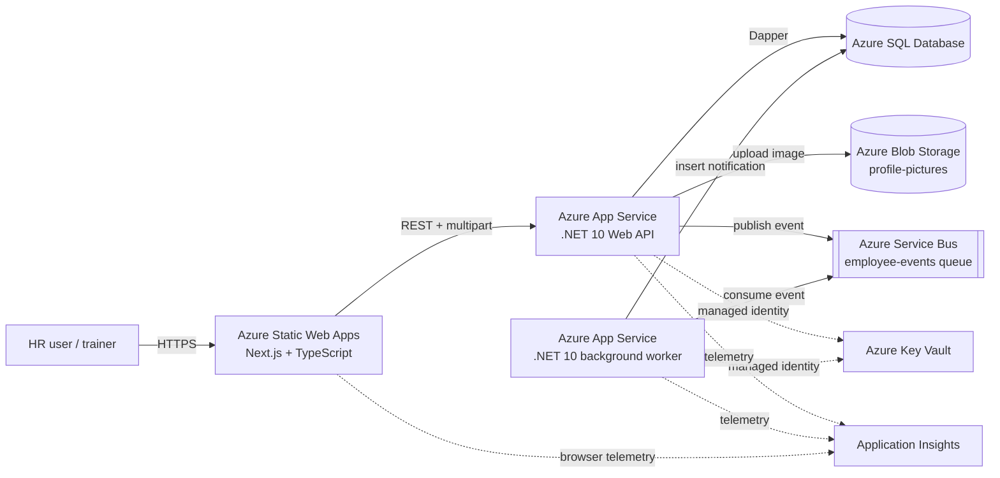

# Employee OnBoarding

A deliberately small, end-to-end Azure Fundamentals sample for fresh graduate engineers. It implements an employee onboarding directory with profile pictures, asynchronous onboarding notifications, infrastructure as code and two CI/CD pipeline options.

The goal is learning value, not production completeness. Every Azure service has a visible job in the running application.

## What the application does

- Lists, creates, edits and deletes employees.
- Stores name, email, department and a profile picture URL in Azure SQL Database.
- Uploads profile pictures to a public-read Blob Storage container and stores only the URL in SQL.
- Publishes an `EmployeeChangedEvent` to an Azure Service Bus queue whenever an employee is created or updated.
- Runs a background worker that consumes the event and inserts a notification row into SQL.
- Shows a live notification feed so the asynchronous flow is visible in the UI.
- Reads secrets from Azure Key Vault through App Service Key Vault references and managed identity.
- Sends backend, worker and browser telemetry to Application Insights.

## Architecture



See [docs/architecture.md](docs/architecture.md) for service justification, request flows and design decisions.

The frontend is exported to static HTML, CSS and JavaScript at build time, so Azure Static Web Apps serves files and the browser calls the API directly. The edit page receives the employee ID in the query string (`/employees/edit?id=...`) because a static export cannot enumerate IDs at build time.

## Technology

| Area | Choice |
| --- | --- |
| Frontend | Next.js 16 static export, React 19, TypeScript, Application Insights browser SDK |
| Backend | .NET 10 Web API, Dapper, Microsoft.Data.SqlClient |
| Worker | .NET 10 hosted background service on App Service |
| Database | Azure SQL Database, SSDT database project, database-first |
| Messaging | Azure Service Bus Standard queue with duplicate detection |
| Storage | Azure Blob Storage container with public blob read access |
| Security | System-assigned managed identities, Key Vault RBAC, Key Vault references |
| Observability | Application Insights, Serilog structured logs, health endpoints |
| Infrastructure | Bicep with reusable modules |
| CI/CD | GitHub Actions and Azure DevOps YAML |

## Repository structure

```text
EmployeeOnBoarding/
├── .azure_devops/
│   └── azure-pipelines.yml
├── .github/
│   └── workflows/
│       └── employee-onboarding.yml
├── backend/
│   ├── database/
│   │   └── EmployeeOnBoarding.Database/
│   │       ├── Tables/
│   │       │   ├── Employees.sql
│   │       │   └── Notifications.sql
│   │       ├── Scripts/
│   │       │   └── SeedData.sql
│   │       └── EmployeeOnBoarding.Database.sqlproj
│   └── src/
│       ├── EmployeeOnBoarding.Api/
│       ├── EmployeeOnBoarding.Contracts/
│       └── EmployeeOnBoarding.Worker/
├── docs/
│   ├── architecture.md
│   ├── azure-resource-mapping.md
│   ├── database-schema.md
│   ├── deployment-guide.md
│   ├── local-development.md
│   └── trainer-notes.md
├── frontend/
├── infra/
│   ├── main.bicep
│   ├── main.parameters.json
│   └── modules/
├── scripts/
│   ├── deploy-database.ps1
│   ├── deploy-infrastructure.ps1
│   ├── set-local-secrets.ps1
│   └── smoke-test.ps1
├── EmployeeOnBoarding.slnx
└── README.md
```

## Azure services demonstrated

| Service | Role in this sample |
| --- | --- |
| Azure Static Web Apps | Hosts the Next.js frontend and connects to the API. |
| Azure App Service | Hosts the .NET API and a separate always-on background worker on one Linux plan. |
| Azure SQL Database | Stores employees and notifications using the SSDT schema. |
| Azure Blob Storage | Stores profile images in the `profile-pictures` container. |
| Azure Service Bus | Decouples employee writes from notification creation. |
| Azure Key Vault | Stores SQL, storage, Service Bus and Application Insights connection strings. |
| Application Insights | Captures requests, dependencies, exceptions, logs and browser page views. |

## API endpoints

| Method | Route | Purpose |
| --- | --- | --- |
| GET | `/health` | App Service health probe. |
| GET | `/api/employees` | List employees. |
| GET | `/api/employees/{id}` | Get one employee. |
| POST | `/api/employees` | Create an employee. Uses `multipart/form-data`. |
| PUT | `/api/employees/{id}` | Update an employee. Uses `multipart/form-data`. |
| DELETE | `/api/employees/{id}` | Delete an employee and their blob. |
| GET | `/api/notifications?take=25` | Read notifications created by the worker. |
| GET | `/swagger` | Swagger UI in the running API. |

Both create and update accept `name`, `email`, `department` and an optional `profilePicture` file. Supported images are JPEG, PNG and WebP up to 5 MB.

## Quick start

The fastest path is to deploy to Azure, then run the frontend and API locally against those resources.

```powershell
cd EmployeeOnBoarding

dotnet build backend/database/EmployeeOnBoarding.Database/EmployeeOnBoarding.Database.sqlproj

$password = Read-Host -AsSecureString "SQL administrator password (12+ characters)"
.\scripts\deploy-infrastructure.ps1 -SqlAdminPassword $password

# Use the SQL server name printed by the previous command, without .database.windows.net
.\scripts\deploy-database.ps1 `
  -ResourceGroup rg-employee-onboarding-dev `
  -SqlServerName sql-eob-dev-xxxxxx `
  -SqlAdminPassword $password `
  -DacpacPath backend/database/EmployeeOnBoarding.Database/bin/Debug/EmployeeOnBoarding.Database.dacpac

.\scripts\set-local-secrets.ps1 -GrantKeyVaultAccess

dotnet run --project backend/src/EmployeeOnBoarding.Api --launch-profile http
dotnet run --project backend/src/EmployeeOnBoarding.Worker --launch-profile http
npm install --prefix frontend
npm run dev --prefix frontend
```

Open `http://localhost:3000`. The API listens on `http://localhost:5215` and Swagger is at `http://localhost:5215/swagger`.

For a complete walkthrough, including CI/CD deployment, see [docs/deployment-guide.md](docs/deployment-guide.md) and [docs/local-development.md](docs/local-development.md).

## Training material

- [Trainer notes and 60-minute agenda](docs/trainer-notes.md)
- [Solution architecture and service justification](docs/architecture.md)
- [Database schema](docs/database-schema.md)
- [Azure resource mapping](docs/azure-resource-mapping.md)

## Intentional simplifications

This sample is optimized for a one-hour class. A production implementation should also add:

- Microsoft Entra ID authentication and role-based authorization.
- Managed identity authentication to SQL, Storage and Service Bus instead of administrator logins and account keys.
- Private endpoints for SQL, Storage, Service Bus and Key Vault.
- Private Blob container access with short-lived SAS URLs or an image proxy.
- An outbox pattern or idempotency key to make database writes and event publishing atomic.
- Deployment slots, custom domains, WAF and autoscaling rules.
- Automated integration tests and a dev/test/prod environment matrix.

These trade-offs are called out during the training so learners see both the “what” and the “why”.

## Clean up

Delete the resource group to remove every resource and stop charges:

```powershell
az group delete --name rg-employee-onboarding-dev --yes --no-wait
```
