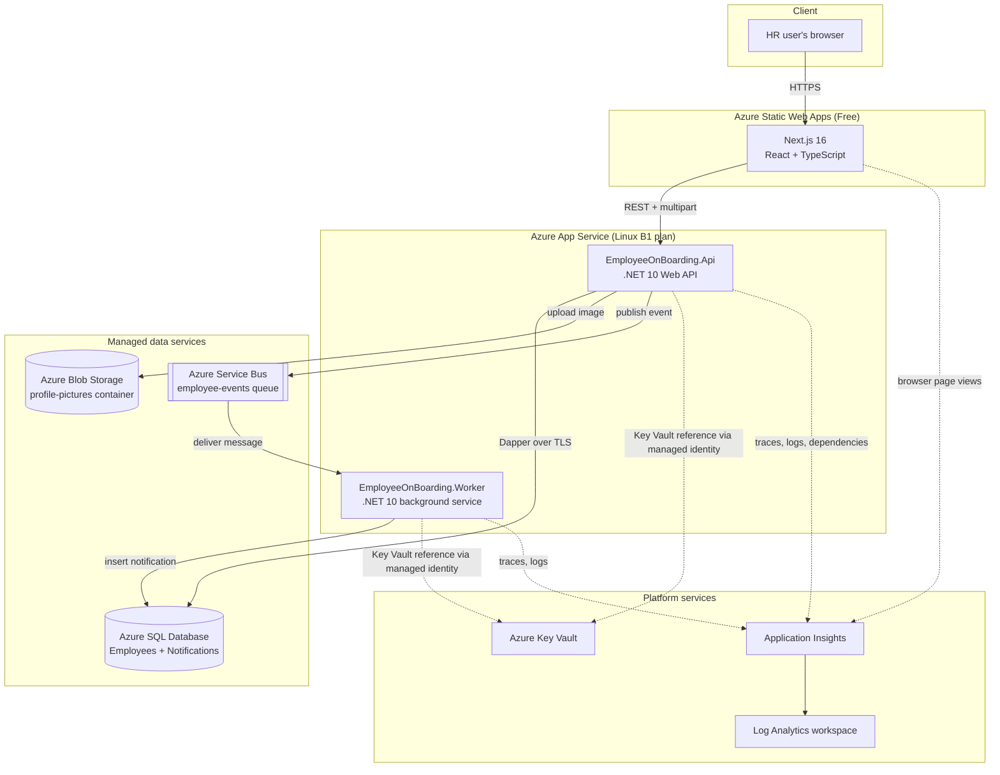
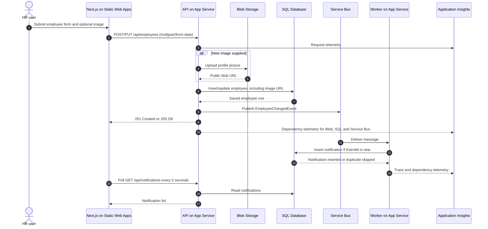

# Solution Architecture

## 1. Context

The Employee OnBoarding application gives People Operations a small directory for new joiners. It deliberately exercises the core Azure Fundamentals services in one request path:

1. A browser loads a Next.js application from Azure Static Web Apps.
2. The browser calls a .NET 10 API on Azure App Service.
3. The API writes employee data to Azure SQL Database and images to Azure Blob Storage.
4. The API publishes an event to Azure Service Bus.
5. A second App Service worker consumes the event and writes a notification to Azure SQL Database.
6. Both services load secrets from Azure Key Vault and emit telemetry to Application Insights.

## 2. Logical architecture



## 3. Runtime flow: create or update an employee



The API response does not wait for notification creation. That is the teaching point for queues: the user-facing write is decoupled from downstream work.

## 4. Component responsibilities

| Component | Responsibility | Why it lives there |
| --- | --- | --- |
| Next.js frontend | Directory UI, forms, image preview, notification feed, browser telemetry | Static Web Apps gives a globally distributed frontend with a free tier and Git-based deployment. |
| API | Validation, image upload, SQL persistence, event publication, notification read API | App Service hosts a standard ASP.NET Core app with minimal operational overhead. |
| Contracts project | Shared `EmployeeChangedEvent` and queue defaults | Publisher and consumer share one versioned message shape. |
| Worker | Service Bus processor, idempotent notification insert | A separate always-on process shows background processing and independent scaling. |
| SQL Database | Durable relational state for employees and notifications | Strong schema, uniqueness constraints and SSDT deployment fit the database-first requirement. |
| Blob Storage | Profile image bytes | Binary content is cheaper and simpler to serve from object storage than from SQL. |
| Service Bus | Durable queue for employee events | Buffers spikes, retries failures and decouples notification creation. |
| Key Vault | Secret material | No connection strings in source control; App Service resolves Key Vault references with managed identity. |
| Application Insights | Distributed telemetry | One place to inspect requests, dependencies, logs and failures across API, worker and browser. |

## 5. Azure service justification

### Azure Static Web Apps

The frontend is a statically exported Next.js application. Static Web Apps provides HTTPS, global distribution, built-in CI/CD integration and a free tier suitable for training. It keeps frontend hosting separate from the API, which makes the frontend/backend boundary easy to explain. Because `next build` produces only static files, the edit page reads the employee ID from a query string and loads the record from the API in the browser.

### Azure App Service

App Service is the simplest managed host for a .NET 10 Web API and a second always-on worker. Both apps share one Linux B1 plan, so the sample demonstrates two app services on one compute plan without extra infrastructure. System-assigned managed identities let both apps read Key Vault. Health checks and structured logs are available without custom tooling.

### Azure SQL Database

Employee and notification records are relational, benefit from uniqueness constraints and are queried with straightforward SQL. An SSDT project gives a reviewable database-first schema and a `.dacpac` artifact that pipelines can publish. Dapper keeps the data access visible and avoids hiding SQL behind an ORM.

### Azure Blob Storage

Profile pictures are unstructured binary data. Keeping bytes out of SQL keeps rows small and backups focused on business data. The API uploads the image and stores only the returned URL in `dbo.Employees.ProfilePictureUrl`. The training version uses public read access on the container so the browser can display images directly; production notes explain the private-container alternative.

### Azure Service Bus

Service Bus provides durable messaging, at-least-once delivery, duplicate detection, retries and a dead-letter queue. The queue lets the API return quickly while a worker creates notifications. Duplicate detection plus a unique `EventId` in SQL makes the consumer idempotent, which is an important cloud-native lesson.

### Azure Key Vault

All connection strings are stored in Key Vault. App Service app settings use Key Vault references such as:

```text
@Microsoft.KeyVault(SecretUri=https://kv-eob-dev-xxxxxx.vault.azure.net/secrets/SqlConnectionString/)
```

The API and worker use their system-assigned managed identities with the `Key Vault Secrets User` role. Nothing sensitive lives in the repository or in the Bicep parameter file.

### Application Insights

Application Insights is wired into the API, worker and browser. The trainer can show request latency, SQL and Blob dependencies, worker traces, exceptions and the live metrics stream. Log Analytics is provisioned as the workspace backing the Application Insights component, which also introduces the workspace-based model.

## 6. Security model

| Control | Implementation |
| --- | --- |
| Transport | HTTPS-only App Service and Static Web Apps; TLS 1.2 minimum on SQL, storage and Service Bus. |
| Secrets at rest | Key Vault with RBAC authorization, soft delete and seven-day retention. |
| Secret access | System-assigned managed identities + `Key Vault Secrets User`. |
| SQL access | Firewall allows Azure services and the deployer/client IP. Administrator credentials are supplied at deployment. |
| CORS | API allows the deployed Static Web App origin and localhost during development. |
| Upload validation | Content type and extension allow-list; 5 MB limit; request form limit 6 MB. |
| Identity | Managed identity used for Key Vault only. End-user authentication is intentionally out of scope for the lab. |

Production hardening would replace SQL administrator authentication with managed identity, add Entra ID to the frontend/API, and use private endpoints.

## 7. Reliability and consistency

- **At-least-once delivery:** Service Bus may deliver a message more than once. The worker uses `IF NOT EXISTS` on the unique `EventId` so duplicates are harmless.
- **Retries and dead-lettering:** The queue has a maximum delivery count of 5 and dead-letters expired messages. Failed messages can be inspected and replayed.
- **Partial failure:** The API writes SQL and then publishes to Service Bus. A production system would use an outbox table to make those two operations atomic. This is a deliberate discussion point in the class.
- **Health checks:** `GET /health` is configured as the App Service health check path on both apps.
- **Observability:** Serilog emits structured logs; Application Insights captures the same operations as requests, dependencies and traces.

## 8. Scaling path

The sample runs one instance of each app. A discussion of scale can cover:

- Static Web Apps already serves the frontend globally.
- App Service can scale out manually or with autoscale rules; the worker can scale independently because it competes for Service Bus messages.
- Service Bus Standard supports competing consumers and dead-lettering.
- SQL Basic is intentionally small; production would use a higher tier, zone redundancy and read scaling.
- Blob Storage can front a CDN and private endpoints can replace public access.
