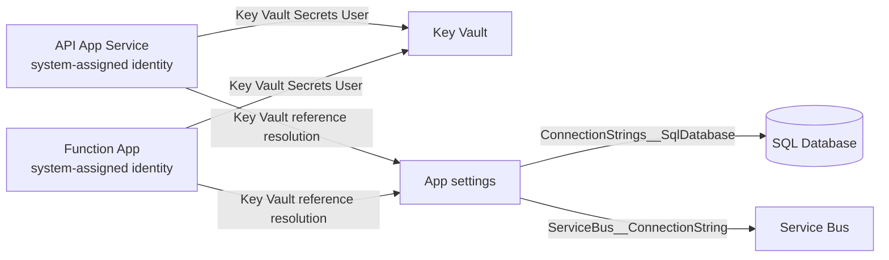

# Azure Resource Mapping

This document maps the logical application components to concrete Azure resources, Bicep modules, configuration and access paths.

## 1. Resource map

| Logical component | Azure resource | Bicep module | SKU / configuration |
| --- | --- | --- | --- |
| Frontend | `Microsoft.Web/staticSites` | `modules/staticWebApp.bicep` | Free, `eastus2`, HTTPS endpoint |
| API host | `Microsoft.Web/sites` | `modules/webApp.bicep` | Linux, `.NET 10`, always on, system-assigned identity |
| Notification host | `Microsoft.Web/sites` (`functionapp,linux`) | `modules/webApp.bicep` | Linux, .NET isolated, always on, system-assigned identity |
| Compute plan | `Microsoft.Web/serverfarms` | `modules/appServicePlan.bicep` | Linux B1, one instance, shared by API and Function App |
| Relational data | `Microsoft.Sql/servers` + `databases` | `modules/sqlDatabase.bicep` | SQL Database Basic, 2 GB |
| Images | `Microsoft.Storage/storageAccounts` + blob service + container | `modules/storage.bicep` | Standard LRS, StorageV2, TLS 1.2, public blob read |
| Messaging | `Microsoft.ServiceBus/namespaces` + queue | `modules/serviceBus.bicep` | Standard, queue `employee-events`, duplicate detection |
| Secrets | `Microsoft.KeyVault/vaults` + secrets | `modules/keyVault.bicep` + secrets in `main.bicep` | Standard, RBAC authorization, soft delete |
| Telemetry | `Microsoft.Insights/components` + Log Analytics workspace | `modules/appInsights.bicep` | Workspace-based Application Insights, 30-day retention |
| Identity access | `Microsoft.Authorization/roleAssignments` | `main.bicep` | `Key Vault Secrets User` for both App Services |

## 2. Naming and parameters

| Parameter | Default | Why it matters |
| --- | --- | --- |
| `environmentName` | `dev` | Included in most names; 2–5 lower-case characters. |
| `namePrefix` | `eob` | Included in most names; 2–5 lower-case characters. |
| `location` | resource group location | Static Web Apps Free needs a supported region; `eastus2` is the sample default. |
| `sqlAdminLogin` | `sqladmin` | SQL administrator login used by the API and Function App connection strings. |
| `sqlAdminPassword` | required, secure | Used for the SQL server and embedded in the Key Vault secret. |
| `allowAllIpAddresses` | `false` | Training escape hatch for SQL network access. Keep false normally. |
| `clientIpAddress` | empty | Single deployment/trainer IP allowed through SQL firewall. |
| `appServicePlanSkuName` / `Tier` | `B1` / `Basic` | One shared plan for API and Function App. |
| `apiLinuxFxVersion` | `DOTNETCORE\|10.0` | Runtime stack for the API. |
| `workerLinuxFxVersion` | `DOTNET-ISOLATED\|10.0` | Runtime stack for the Functions isolated worker. |

Resource names are deterministic within a subscription/resource group/environment. Redeploying the same parameters targets the same resources.

## 3. App Service configuration and Key Vault mapping

### API app settings

| App setting | Value source | Purpose |
| --- | --- | --- |
| `ConnectionStrings__SqlDatabase` | `@Microsoft.KeyVault(SecretUri=.../secrets/SqlConnectionString/)` | SQL connection string. |
| `ConnectionStrings__BlobStorage` | `@Microsoft.KeyVault(SecretUri=.../secrets/StorageConnectionString/)` | Storage account connection string. |
| `ServiceBus__ConnectionString` | `@Microsoft.KeyVault(SecretUri=.../secrets/ServiceBusConnectionString/)` | Publish events. |
| `ServiceBus__QueueName` | `employee-events` | Queue name. |
| `Storage__ContainerName` | `profile-pictures` | Blob container name. |
| `Cors__AllowedOrigins__0` | `https://<static-web-app-hostname>` | Browser origin allowed to call the API. |
| `APPLICATIONINSIGHTS_CONNECTION_STRING` | Key Vault reference | Application Insights telemetry. |
| `ASPNETCORE_ENVIRONMENT` | `Production` | Runtime environment. |
| `WEBSITES_PORT` | `8080` | Port expected by App Service Linux. |

### Function App settings

| App setting | Value source | Purpose |
| --- | --- | --- |
| `AzureWebJobsStorage` | Key Vault reference | Functions host storage. |
| `FUNCTIONS_EXTENSION_VERSION` | `~4` | Azure Functions host version. |
| `FUNCTIONS_WORKER_RUNTIME` | `dotnet-isolated` | Isolated .NET worker runtime. |
| `WEBSITE_RUN_FROM_PACKAGE` | `1` | Run the deployed package. |
| `ConnectionStrings__SqlDatabase` | Key Vault reference | Write notifications. |
| `ServiceBusConnection` | Key Vault reference | Consume events. |
| `ServiceBusQueueName` | `employee-events` | Queue name used by the trigger binding. |
| `APPLICATIONINSIGHTS_CONNECTION_STRING` | Key Vault reference | Function telemetry. |

The Functions project contains an isolated worker with a Service Bus trigger. The host manages message completion and retries; `host.json` sets two concurrent calls and five minutes of lock renewal.

## 4. Key Vault secrets

| Secret name | Content | Consumers |
| --- | --- | --- |
| `SqlConnectionString` | SQL server FQDN, database, administrator login and password | API, Function App |
| `StorageConnectionString` | Storage account name and key | API, Function App (`AzureWebJobsStorage`) |
| `ServiceBusConnectionString` | Service Bus namespace connection string | API, Function App |
| `ApplicationInsightsConnectionString` | Application Insights connection string | API, Function App, optional browser |

The Key Vault uses `enableRbacAuthorization: true`. App Service identities receive the built-in role definition ID `4633458b-17de-408a-b874-0445c86b69e6` (`Key Vault Secrets User`).

## 5. Managed identity and access path



The app does not call the Key Vault SDK directly. App Service resolves `@Microsoft.KeyVault(...)` references before the process starts and presents the resulting values as environment variables. That keeps application code simple while still demonstrating managed identity and RBAC.

## 6. SQL network access

Bicep creates:

- `AllowAzureServices` firewall rule (`0.0.0.0`–`0.0.0.0`).
- `AllowDeploymentClient` rule for the single IP passed as `clientIpAddress`.
- Optional `AllowAllIpsForTraining` rule when `allowAllIpAddresses` is true.

The CI/CD pipelines add a temporary rule for the runner when publishing the dacpac, then remove it. The manual deployment script does the same.

`AllowAzureServices` is not a general “all Azure traffic is trusted” security boundary. It is a SQL Server firewall convenience. Production designs should use private endpoints and managed identity for SQL authentication.

## 7. Storage layout

```text
Storage account
└── profile-pictures/           public read access at the blob level
    └── employees/
        └── yyyy/
            └── MM/
                └── <guid>.<jpg|png|webp>
```

The API writes the absolute blob URL to `dbo.Employees.ProfilePictureUrl`. Deleting an employee removes the blob. Replacing a profile picture uploads a new blob and removes the old one after the SQL update succeeds.

## 8. Service Bus layout

```text
Service Bus namespace
└── employee-events queue
    ├── maxDeliveryCount: 5
    ├── lockDuration: 1 minute
    ├── duplicate detection window: 10 minutes
    ├── dead-lettering on expiration: enabled
    └── message body: EmployeeChangedEvent JSON
```

The API sets `MessageId` to the event ID. The queue also uses duplicate detection. The Function writes the same event ID into a unique SQL column, giving two layers of idempotency.

## 9. Deployment outputs

After Bicep deployment, these outputs are available for scripts and pipelines:

| Output | Use |
| --- | --- |
| `frontendUrl` | Open the application. |
| `apiUrl` | Set `NEXT_PUBLIC_API_BASE_URL`; run smoke tests. |
| `swaggerUrl` | API exploration. |
| `apiAppName` | `az webapp deploy` target. |
| `workerAppName` | `az functionapp deployment source config-zip` target (legacy output name). |
| `staticWebAppName` | Retrieve the Static Web Apps deployment token. |
| `keyVaultName` | Inspect secret metadata. |
| `sqlServerName` | SQL connection and dacpac deployment. |
| `sqlDatabaseName` | Query the database. |
| `storageAccountName` | Inspect uploaded blobs. |
| `serviceBusNamespaceName` | Inspect queue metrics. |
| `serviceBusQueueName` | Inspect queue metrics. |
| `applicationInsightsName` | Open telemetry. |

No secret values are emitted as deployment outputs. Connection strings are generated inside the deployment and written directly to Key Vault.
