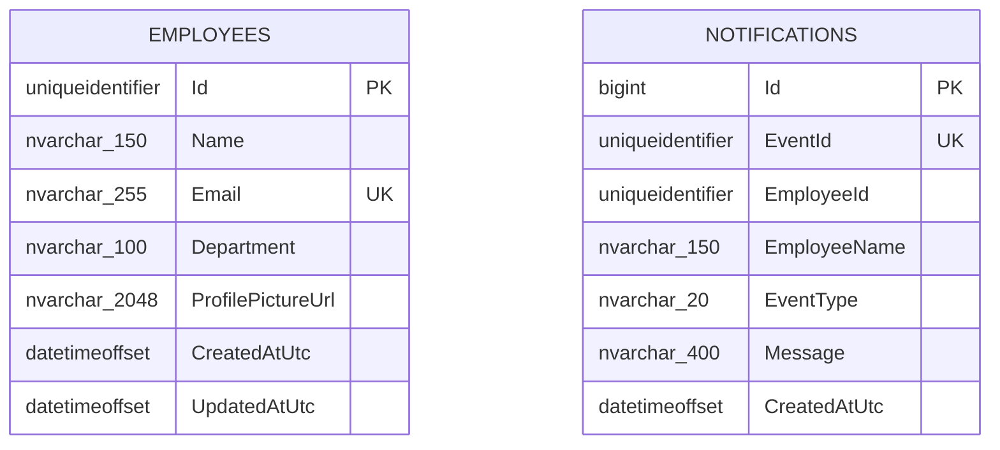

# Database Schema

The database is defined by an SSDT-compatible Microsoft.Build.Sql project at `backend/database/EmployeeOnBoarding.Database`. The API uses Dapper and plain SQL against this schema; there is no ORM or code-first migration.

## 1. Entity relationship diagram



`Notifications.EmployeeId` intentionally has no foreign key. Notifications are an event-driven projection and remain readable if an employee is later deleted. This is a small example of bounded contexts and decoupled data.

## 2. `dbo.Employees`

| Column | Type | Null | Notes |
| --- | --- | --- | --- |
| `Id` | `uniqueidentifier` | No | Primary key. Generated by the API with `Guid.NewGuid()`. |
| `Name` | `nvarchar(150)` | No | Display name. |
| `Email` | `nvarchar(255)` | No | Lower-cased by the API; unique constraint. |
| `Department` | `nvarchar(100)` | No | Free-form department name. A lookup table would be a production refinement. |
| `ProfilePictureUrl` | `nvarchar(2048)` | Yes | Blob URL only; image bytes are not stored in SQL. |
| `CreatedAtUtc` | `datetimeoffset(0)` | No | Defaults to `SYSUTCDATETIME()`. |
| `UpdatedAtUtc` | `datetimeoffset(0)` | No | Updated on every employee update. |

Constraints and indexes:

- `PK_Employees` clustered primary key on `Id`.
- `UQ_Employees_Email` unique nonclustered constraint on `Email`.
- `IX_Employees_Name` supports name ordering/search.

## 3. `dbo.Notifications`

| Column | Type | Null | Notes |
| --- | --- | --- | --- |
| `Id` | `bigint identity` | No | Primary key, database-generated. |
| `EventId` | `uniqueidentifier` | No | Idempotency key from `EmployeeChangedEvent.EventId`; unique constraint. |
| `EmployeeId` | `uniqueidentifier` | No | Employee referenced by the event. No FK by design. |
| `EmployeeName` | `nvarchar(150)` | No | Denormalized for a readable feed. |
| `EventType` | `nvarchar(20)` | No | `Created` or `Updated`. |
| `Message` | `nvarchar(400)` | No | Human-readable notification generated by the Functions listener. |
| `CreatedAtUtc` | `datetimeoffset(0)` | No | Defaults to `SYSUTCDATETIME()`. |

Constraints and indexes:

- `PK_Notifications` clustered primary key on `Id`.
- `UQ_Notifications_EventId` unique nonclustered constraint on `EventId`, enforcing idempotency.
- `IX_Notifications_CreatedAtUtc` descending index for the recent-notifications feed.

## 4. Seed data

`Scripts/SeedData.sql` is configured as a post-deployment script in the SQL project. It inserts four sample employees only when `dbo.Employees` is empty. Notifications start empty so the asynchronous flow is visible during the demo.

## 5. Deployment

Build the project:

```powershell
dotnet build backend/database/EmployeeOnBoarding.Database/EmployeeOnBoarding.Database.sqlproj -c Release
```

Output:

```text
backend/database/EmployeeOnBoarding.Database/bin/Release/EmployeeOnBoarding.Database.dacpac
```

Publish:

```powershell
sqlpackage `
  /Action:Publish `
  /SourceFile:backend/database/EmployeeOnBoarding.Database/bin/Release/EmployeeOnBoarding.Database.dacpac `
  "/TargetConnectionString:Server=tcp:<server>.database.windows.net,1433;Initial Catalog=EmployeeOnBoarding;User ID=sqladmin;Password=<password>;Encrypt=True;"
```

The Bicep deployment creates the database. The dacpac publish creates and updates the schema and runs the seed script. Both CI/CD pipelines publish the same dacpac.

## 6. Demo queries

```sql
SELECT Id, Name, Email, Department, ProfilePictureUrl, UpdatedAtUtc
FROM dbo.Employees
ORDER BY Name;

SELECT TOP (20) EventId, EmployeeName, EventType, Message, CreatedAtUtc
FROM dbo.Notifications
ORDER BY CreatedAtUtc DESC;

SELECT COUNT(*) AS EmployeeCount FROM dbo.Employees;
SELECT COUNT(*) AS NotificationCount FROM dbo.Notifications;
```

To replay the asynchronous demo, clear notifications and add or edit an employee:

```sql
DELETE FROM dbo.Notifications;
```

To reset the directory entirely:

```sql
DELETE FROM dbo.Notifications;
DELETE FROM dbo.Employees;
```

Then re-publish the dacpac to restore the seed rows, or add employees from the UI.
